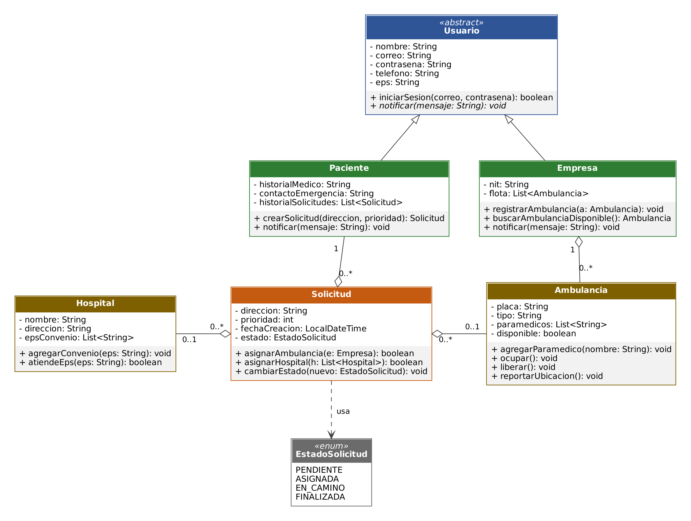
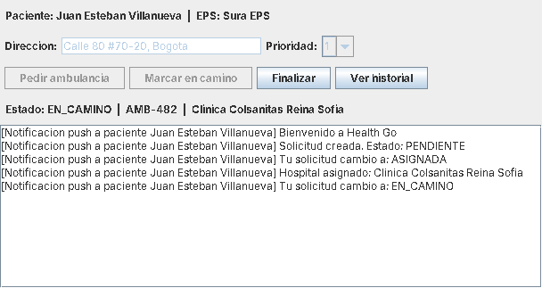

# Health Go

Sistema de gestión de solicitudes de ambulancias en Bogotá, hecho en Java con Programación Orientada a Objetos.

Proyecto de la materia Paradigmas de Programación, Politécnico Grancolombiano (2026).

**Integrantes:** Juan Esteban Villanueva Restrepo y Juan Esteban Moreno Alayon
**Docente:** Diana Carolina Arias Sosa

## Qué hace

Un paciente inicia sesión, crea una solicitud de ambulancia y la empresa le asigna una unidad libre. El sistema elige un hospital que tenga convenio con la EPS del paciente y le avisa cada vez que cambia el estado de la solicitud (pendiente, asignada, en camino, finalizada).

Se puede usar de dos formas: por consola (`Main`) o con una ventana con botones (`VentanaHealthGo`).

## Diagrama de clases



## Clases

| Clase | Qué es |
| --- | --- |
| `Usuario` | Clase abstracta con los datos de login. Declara `notificar()` como abstracto. |
| `Paciente` | Hereda de `Usuario`. Crea solicitudes y guarda su historial. |
| `Empresa` | Hereda de `Usuario`. Administra la flota de ambulancias. |
| `Ambulancia` | Placa, tipo, paramédicos (`List<String>`) y disponibilidad. |
| `Hospital` | Nombre, dirección y lista de EPS con convenio. |
| `Solicitud` | Une paciente, ambulancia y hospital (agregación) y controla el estado. |
| `EstadoSolicitud` | Enum con los cuatro estados posibles. |
| `Main` | Clase de prueba por consola: recorre el flujo completo. |
| `VentanaHealthGo` | Ventana con botones (Swing). Solo usa el modelo, no lo modifica. |

## Conceptos de POO aplicados

- **Abstracción:** `Usuario` es abstracta.
- **Herencia:** `Paciente` y `Empresa` heredan de `Usuario`.
- **Polimorfismo:** `notificar()` se comporta distinto según el tipo de usuario.
- **Encapsulamiento:** atributos privados, getters sin setters y listas devueltas como solo lectura.
- **Agregación:** `Solicitud` referencia a `Paciente`, `Ambulancia` y `Hospital`; `Empresa` agrupa su flota.

## Cómo ejecutarlo

Requiere Java 17 o superior.

Por consola:

```bash
mkdir out
javac -d out /healthgo/*.java
java -cp out healthgo.Main
```

Con la ventana de botones:

```bash
java -cp out healthgo.VentanaHealthGo
```

Datos de prueba para iniciar sesión: correo `juan@correo.com` y contraseña `1234`.

En NetBeans: copiar los archivos al paquete `healthgo` y ejecutar `Main.java` o `VentanaHealthGo.java` con **Run File**.

## Ventana


